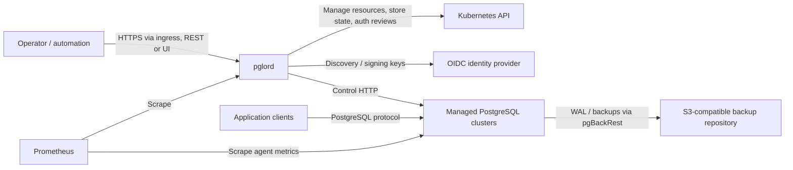
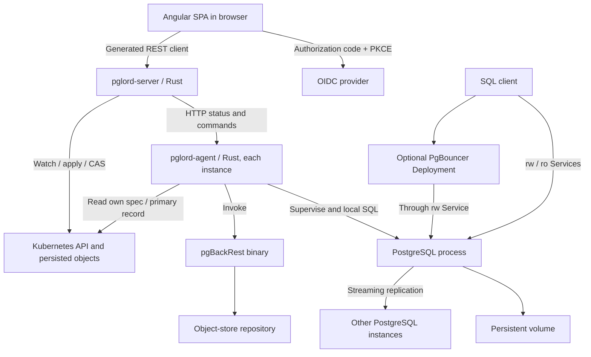

# pglord architecture — current implementation

This baseline describes implemented boundaries, not a guarantee of production safety.
It replaces historical planning assumptions with source-grounded context and container
views. Read the [user guide](../user-guide.md) for operations and
[development process](../development.md) for change/verification gates.

## C4 level 1: system context

Operators manage cluster lifecycle; applications connect to stable read/write,
read-only or optional pooler Services. Kubernetes supplies orchestration and durable
control records; storage volumes hold database data. The backup repository is external
and is not a substitute for a tested restore procedure.

## C4 level 2: containers

The SPA is embedded in the server image, but executes in the browser. PostgreSQL,
agent and pgBackRest share the instance container; they are separated above to show
process responsibilities. PgBouncer is a separate Deployment, not a sidecar.
There is no separate pglord database. Core is a library, not a deployed service.

## Code boundaries and state

- [Core](../../crates/pglord-core/src/lib.rs): pure specs, validation, rendering and
  config/SQL builders. Reserved GUCs and labels protect controller-owned settings.
- [Server composition](../../crates/pglord-server/src/app.rs): one router/OpenAPI seam.
  [Reconciler](../../crates/pglord-server/src/reconciler.rs) converges desired resources;
  [orchestrator](../../crates/pglord-server/src/orchestrator.rs) observes agents and
  elects a ready standby using WAL position.
- [Spec store](../../crates/pglord-server/src/spec_store.rs): default desired spec is
  serialized in `<name>-spec` ConfigMap. [CRD store](../../crates/pglord-server/src/crd_store.rs)
  supports PostgresCluster resources; a mirror ConfigMap retains the agent/control-loop
  record interface. Cluster-wide mode requires CRD storage and namespace-aware access.
- [Primary record](../../crates/pglord-server/src/primary_record.rs): `pglord.dev/primary`
  identifies the authoritative primary pod. Primary and upgrade annotations use
  resourceVersion compare-and-swap. Whole-spec writes are separate operations, not a
  transaction with annotation changes or resource deletion.
- [Agent](../../crates/pglord-agent/src/main.rs): PID 1 supervises PostgreSQL, bootstraps
  primary/standby/restore and follows the record. [Record following](../../crates/pglord-agent/src/record.rs)
  promotes a recorded standby and fences a deposed primary once the changed record is
  observed. Cross-generation records are deliberately ignored for role actions.
- [Backup history](../../crates/pglord-server/src/backup_runs.rs) persists run records in
  a per-cluster ConfigMap; [scheduler](../../crates/pglord-server/src/backup_scheduler.rs)
  executes schedules. Do not infer distributed locking or leader election from persistence.

## Invariants and tradeoffs to preserve

**Resource ownership.** [Rendering](../../crates/pglord-core/src/render.rs) attaches
ownership references for garbage collection. Stable Services and credentials coexist
with generation-specific StatefulSets. The initial generation uses the legacy unsuffixed
name. StatefulSets use OnDelete updates; template changes alone do not restart pods.
The StatefulSet PVC policy retains scale-down volumes but deletes them with StatefulSet
deletion; the API scale-down path separately deletes orphan PVCs. Do not treat reducing
replica count through the API as a guarantee that removed replicas' volumes survive.

**Failover.** CAS prevents two record writers winning the same version; it does not
fence PostgreSQL by itself. Current agents keep running when the record is unreadable,
and the orchestrator can promote after failed probes without old-primary fencing
confirmation. A network partition can therefore leave two writable databases. Do not
claim partition-safe single-writer authority from this implementation.

**Configuration.** The curated GUC surface reserves HA-critical settings. Reload-safe
values converge via agent reload; restart-required values surface pending restart.
Strict synchronous replication can block writes without a synchronous standby; do not
silently weaken it to asynchronous operation. Fencing and hibernation are desired state,
not ad-hoc pod deletion. A hibernated cluster intentionally has no running instances.

**Credentials and provisioning.** Credentials are referenced Kubernetes Secrets, not
spec contents. Managed credential rotation updates the Secret, applies SQL on primary
and rolls instances; partial failure needs explicit reasoning. Roles, databases and
extensions removed from the spec are left in place, not dropped. Preload configuration
is declarative; a missing library can prevent PostgreSQL starting. Init scripts execute
only at initial creation, not as ongoing migrations.

**TLS and pooling.** TLS uses a referenced certificate Secret, including optional client
CA; pglord does not issue certificates. Enabling TLS does not by itself prohibit plaintext
clients: access rules matter. PgBouncer authenticates via a managed lookup role/function,
uses the stable rw Service, and follows cluster TLS configuration.

**Backups and restore.** pgBackRest supplies backup/WAL mechanics; pglord orchestrates
runs and schedules. [Restore](../../crates/pglord-agent/src/bootstrap.rs) targets a new
cluster, tracks completion and disables inherited archiving before boot to protect the
source repository. An archive-recovering instance must not be prematurely promoted.

**Major upgrades.** [Upgrade API](../../crates/pglord-server/src/api/upgrade.rs) records
Migrating/Soaking/Upgrading state in an annotation. Blue-green uses a second generation,
logical replication, a write-fenced cutover, sequence synchronization and a primary-record
switch. There is no reverse replication: rollback can abandon writes accepted on green.
Green archiving is disabled until finalization updates the stanza and rolls the pods.
Current database enumeration excludes `postgres`; user data there is not migrated.
Finalization also has a retry hazard after adopting the new generation: it can derive the
wrong deletion target. Treat these as defects, not supported constraints.

[In-place upgrades](../../crates/pglord-agent/src/pgupgrade.rs) use `pg_upgrade --link`
with old binaries supplied by an init container. This avoids a duplicate full data copy
but requires downtime and restore-based rollback. Standbys re-clone. The current directory
handoff is not crash-safe between deleting old PGDATA and renaming converted data; startup
can initialize an empty primary. Failover is suppressed during soaking/in-place conversion.

## Trust boundaries and deployment

Public API auth is optional and open by default. Static tokens are full admin. OIDC is
also full admin unless Kubernetes RBAC authorization is enabled. Kubernetes tokens use
TokenReview plus SubjectAccessReview; OIDC RBAC maps validated claims to the same
review mechanism. Health/readiness/metrics are public. See the
[authentication guide](../user-guide.md#11-authentication).

Agent control endpoints use unauthenticated in-cluster HTTP and can perform powerful
operations. Public API authentication does not secure this channel. Restrict network
reachability and do not expose it to untrusted workloads. PostgreSQL TLS is a different
boundary from API ingress TLS and agent transport security.

The [Helm chart](../../charts/pglord/values.yaml) defaults to one server replica.
Multiple replicas run reconciliation and scheduling independently; do not advertise
multi-replica safety without testing concurrent operations. The
[raw deployment](../../deploy/k8s/deployment.yaml) is a local minikube stand with local
images. Keep config/RBAC capabilities aligned while retaining those intentional differences.

## Maintenance assessment

This documentation migration changes no runtime architecture. Context/container views
were required because the previous guidance omitted implemented CRD and cluster-wide
modes and overstated invariants. No historical ADR approvals are inferred. Future changes
to ownership, primary authority, storage, auth or process boundaries must reassess these
views and the relevant recovery tests.
