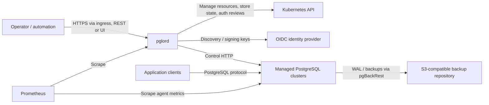
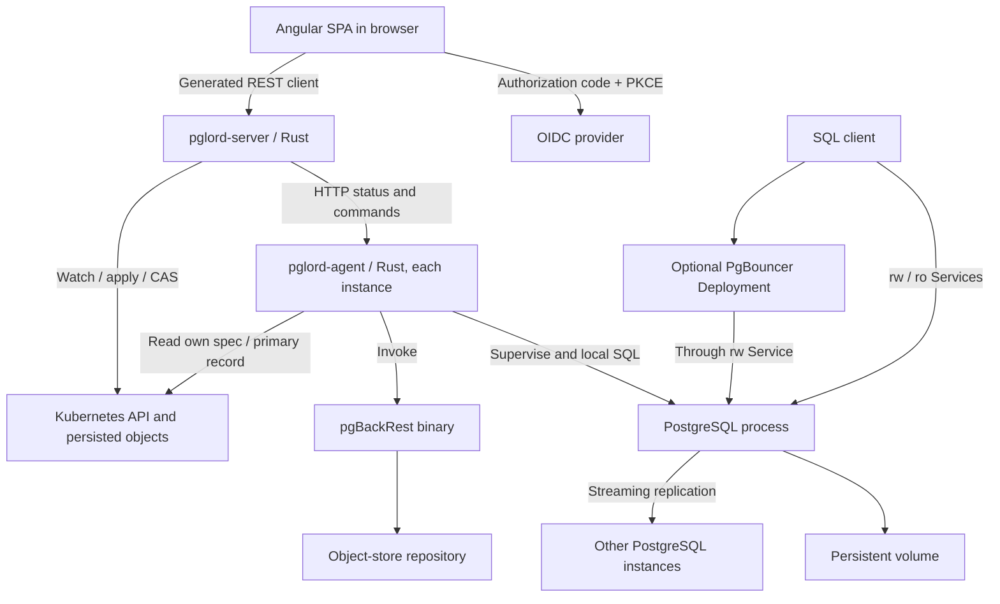

# pglord architecture — current implementation

This baseline describes implemented boundaries, not a guarantee of production safety.
It replaces historical planning assumptions with source-grounded context and container
views. Read the [user guide](../user-guide.md) for operations and
[development process](../development.md) for change/verification gates.

## C4 level 1: system context

Operators manage cluster lifecycle; applications connect to stable read/write,
read-only or optional pooler Services. Kubernetes supplies orchestration and durable
control records; storage volumes hold database data. The backup repository is external
and is not a substitute for a tested restore procedure.

## C4 level 2: containers

The SPA is embedded in the server image, but executes in the browser. PostgreSQL,
agent and pgBackRest share the instance container; they are separated above to show
process responsibilities. PgBouncer is a separate Deployment, not a sidecar.
There is no separate pglord database. Core is a library, not a deployed service.

## Code boundaries and state

- [Core](../../crates/pglord-core/src/lib.rs): pure specs, validation, rendering and
  config/SQL builders. Reserved GUCs and labels protect controller-owned settings.
- [Server composition](../../crates/pglord-server/src/app.rs): one router/OpenAPI seam.
  [Reconciler](../../crates/pglord-server/src/reconciler.rs) converges desired resources;
  [orchestrator](../../crates/pglord-server/src/orchestrator.rs) observes agents and
  elects a ready standby using WAL position.
- [Spec store](../../crates/pglord-server/src/spec_store.rs): default desired spec is
  serialized in `<name>-spec` ConfigMap. [CRD store](../../crates/pglord-server/src/crd_store.rs)
  supports PostgresCluster resources; a mirror ConfigMap retains the agent/control-loop
  record interface. Cluster-wide mode requires CRD storage and namespace-aware access.
  Creates use POST and updates carry the revision observed with their source spec;
  stale writers conflict instead of replacing newer intent. PVC expansion follows the
  winning spec update; a failed expansion leaves desired size saved and is retried by
  explicitly sending the same storage-size request.
- [Primary record](../../crates/pglord-server/src/primary_record.rs): `pglord.dev/primary`
  identifies the authoritative primary pod. Primary and upgrade annotations use
  resourceVersion compare-and-swap. Whole-spec writes are separate operations, not a
  transaction with annotation changes or resource deletion.
- [Agent](../../crates/pglord-agent/src/main.rs): PID 1 supervises PostgreSQL, bootstraps
  primary/standby/restore and follows the record. [Record following](../../crates/pglord-agent/src/record.rs)
  promotes a recorded standby and fences a deposed primary once the changed record is
  observed. Cross-generation records are deliberately ignored for role actions.
- [Backup history](../../crates/pglord-server/src/backup_runs.rs) persists run records in
  a per-cluster ConfigMap; [scheduler](../../crates/pglord-server/src/backup_scheduler.rs)
  executes schedules. Create-only/revision-checked admission permits one recorded running
  backup; revision-checked completion preserves concurrent history. Read errors fail closed.
  An unknown outcome requires operator reconciliation, not an age-based unlock.

## Invariants and tradeoffs to preserve

**Resource ownership.** [Rendering](../../crates/pglord-core/src/render.rs) attaches
ownership references for garbage collection. Stable Services and credentials coexist
with generation-specific StatefulSets. The initial generation uses the legacy unsuffixed
name. StatefulSets use OnDelete updates; template changes alone do not restart pods.
Normal rolls stop on deletion/readiness failure and require a new nonterminating pod
UID plus Kubernetes and agent readiness before touching the next instance.
The StatefulSet PVC policy retains scale-down volumes but deletes them with StatefulSet
deletion. API scale-down also retains volumes: deleting an orphan could race a later
scale-up. Operators must explicitly clean up unused volumes after checking current state.

**Failover.** CAS prevents two record writers winning the same version; it does not
fence PostgreSQL by itself. Automatic failover and manual switchover require the old
primary in the durable fenced list and its agent reporting the boot-time fenced hold.
Unreachable or missing pods are not fencing proof. Managed agent startup fails closed
when authority cannot be read. Planned switching first fences the current primary,
interrupting writes, then waits for acknowledgement. This trades availability for safety.
The proof assumes trusted agent HTTP, a single live pod incarnation and coordinated
spec/record authority; CRD-to-ConfigMap mirror updates are not one atomic transaction.
Do not force-delete a partitioned pod and assume its replacement fenced the old process.

**Configuration.** The curated GUC surface reserves HA-critical settings. Reload-safe
values converge via agent reload; restart-required values surface pending restart.
Strict synchronous replication can block writes without a synchronous standby; do not
silently weaken it to asynchronous operation. Fencing and hibernation are desired state,
not ad-hoc pod deletion. A hibernated cluster intentionally has no running instances.

**Credentials and provisioning.** Credentials are referenced Kubernetes Secrets, not
spec contents. Managed credential rotation updates the Secret, applies SQL on primary
and rolls instances; partial failure needs explicit reasoning. Roles, databases and
extensions removed from the spec are left in place, not dropped. Preload configuration
is declarative; a missing library can prevent PostgreSQL starting. Init scripts execute
only at initial creation, not as ongoing migrations.

**TLS and pooling.** TLS uses a referenced certificate Secret, including optional client
CA; pglord does not issue certificates. Enabling TLS does not by itself prohibit plaintext
clients: access rules matter. PgBouncer authenticates via a managed lookup role/function,
uses the stable rw Service, and follows cluster TLS configuration.

**Backups and restore.** pgBackRest supplies backup/WAL mechanics; pglord orchestrates
runs and schedules. [Restore](../../crates/pglord-agent/src/bootstrap.rs) targets a new
cluster, tracks completion and disables inherited archiving before boot to protect the
source repository. An archive-recovering instance must not be prematurely promoted.

**Major upgrades.** [Upgrade API](../../crates/pglord-server/src/api/upgrade.rs) records
Migrating/Soaking/Upgrading state in an annotation. Blue-green uses a second generation,
logical replication, a write-fenced cutover, sequence synchronization and a primary-record
switch. There is no reverse replication: rollback can abandon writes accepted on green.
Green archiving is disabled until finalization updates the stanza and rolls the pods.
Database enumeration includes `postgres` alongside other non-template databases.
Schema import cleans precreated managed objects within an error-stopping transaction.
Finalization derives the source from immutable previous-primary identity, claims cleanup
before destructive work, and checks expected upgrade state for transitions. Missing
legacy source identity fails closed; rollback cannot revive a claimed source.

[In-place upgrades](../../crates/pglord-agent/src/pgupgrade.rs) use `pg_upgrade --link`
with old binaries supplied by an init container. This avoids a duplicate full data copy
but requires downtime and restore-based rollback. A versioned, permanent spec flag
selects Parallel pod management before replacement. The shared reconciler migrates the
immutable controller policy using Retain safeguards, orphan deletion with UID/version
preconditions and create-only recovery; it rejects policy downgrade by stale writers.
Fresh spec/mirror/CR and upgrade checks reject stale work before mutations and retries;
these checks are not a cross-resource transaction. CR/mirror lag pauses application
until the mirror catches up, and a source-change/child-write race remains possible.
Standbys replace into a paused state before primary conversion, then re-clone only
when the primary advertises their target major. Target agent images must implement
that protocol. A bounded orchestrator pass advances at most one replacement from
persisted state, independently of UI reads, and retries settlement until backup
stanza upgrade is acknowledged. Synchronous replication policy is unchanged. The current directory
handoff uses a durable completed-conversion marker and a retained old directory before
promoting converted data. Startup recovers interrupted handoffs before restore/initdb;
ambiguous incomplete conversion artifacts stop startup rather than initialize over data. Failover is suppressed during soaking/in-place conversion.

## Trust boundaries and deployment

Public API auth is optional and open by default. Static tokens are full admin. OIDC is
also full admin unless Kubernetes RBAC authorization is enabled. Kubernetes tokens use
TokenReview plus SubjectAccessReview; OIDC RBAC maps validated claims to the same
review mechanism. OIDC signing-key cache hits expire five minutes after a successful
fetch; refresh failures cannot extend trust in stale keys. Health/readiness/metrics are public. See the
[authentication guide](../user-guide.md#11-authentication).

Agent control endpoints use unauthenticated in-cluster HTTP and can perform powerful
operations. Public API authentication does not secure this channel. Restrict network
reachability and do not expose it to untrusted workloads. PostgreSQL TLS is a different
boundary from API ingress TLS and agent transport security.

The [Helm chart](../../charts/pglord/values.yaml) defaults to one server replica.
Multiple replicas run reconciliation and scheduling independently; do not advertise
multi-replica safety without testing concurrent operations. The
[raw deployment](../../deploy/k8s/deployment.yaml) is a local minikube stand with local
images. Keep config/RBAC capabilities aligned while retaining those intentional differences.

## Maintenance assessment

The safety repairs change component contracts, not containers: revision-checked spec
writes, shared backup admission, finite JWKS freshness, acknowledged fencing and
recoverable upgrade handoff. These views describe those boundaries and retain explicit
cross-resource/trusted-agent limitations. No historical ADR approvals are inferred. Future changes
to ownership, primary authority, storage, auth or process boundaries must reassess these
views and the relevant recovery tests.
